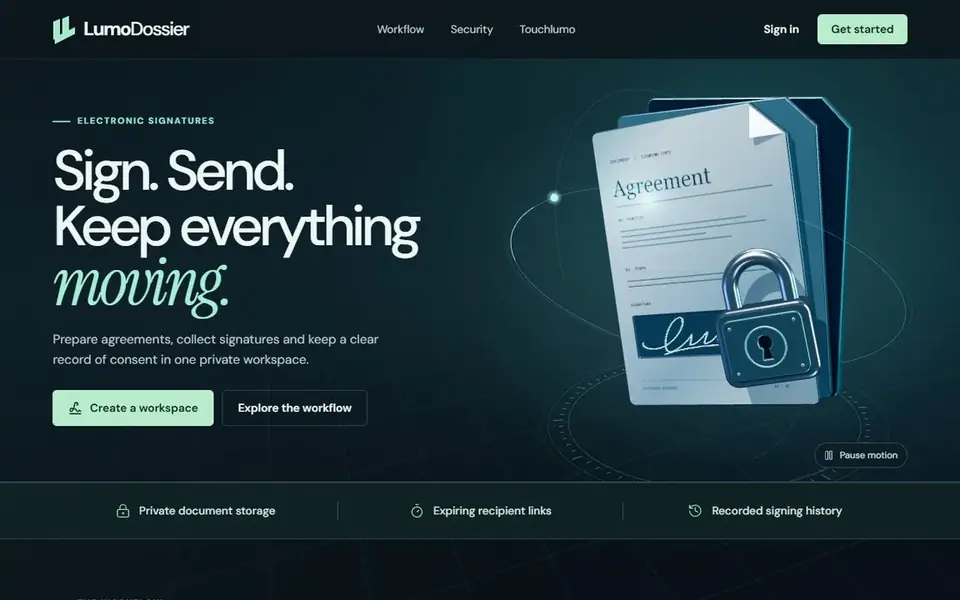

# LumoDossier

**Sign. Send. Keep everything moving.**

LumoDossier is an electronic-signature workspace for business PDFs. The public home page fits on one screen, with a moving 3D agreement and controls to create an account or sign in. Registration and password recovery open on that page. The private sender dashboard, recipient signing room and optional Touchlumo component share the same NestJS API. Recipients open an expiring signing link without creating an account.

[Open LumoDossier at lumodossier.com](https://lumodossier.com)



[View the high-resolution agreement and lock](docs/images/agreement-detail.png)

## Run with your own isolated services

Use Node 24.19.x and pnpm 12.5.1. The hosted design uses Supabase PostgreSQL 15 or later, Supabase Auth and a private Google Cloud Storage bucket. Set up the database login, bucket permissions and email provider for your environment. [Google Cloud deployment guide](docs/google-cloud.md)

1. At the repository root run `pnpm install --frozen-lockfile`. Copy `.env.example` to `.env` and enter the API settings. `LINK_SECRET` must be generated once and retained. For example, run `node -e "console.log(require('node:crypto').randomBytes(48).toString('base64url'))"` locally.
2. In `apps/web/.env.local` set `NEXT_PUBLIC_API_ORIGIN`, `NEXT_PUBLIC_SUPABASE_URL` and `NEXT_PUBLIC_SUPABASE_PUBLISHABLE_KEY`. The frontend needs only these public settings. Next.js reads them when building browser code.
3. Enable password authentication and email confirmation in the isolated Supabase project. For local development, use `http://localhost:3000` as the Site URL and allow `http://localhost:3000/dashboard` and `http://localhost:3000/?account=reset` as redirects. Configure Supabase Auth mail separately from signature invitations.
4. Run `pnpm migrate` with the schema-owner connection in `MIGRATION_DATABASE_URL`. Give the runtime database login membership in `lumo_service` and configure its connection in `DATABASE_URL`. The migration runner locks concurrent runs and checks the checksum of each applied migration.
5. Run `pnpm dev`. Open the [website](http://localhost:3000) and the [API health check](http://localhost:4000/health). Sign up, confirm your email and create a workspace. Personal workspaces start empty.

For a production build, run `pnpm build`. Start each service independently with `pnpm --filter @lumo/web start` and `pnpm --filter @lumo/api start`. Each accepts its own `PORT` and binds to `0.0.0.0`.

## Local hands-on preview

The optional `pnpm preview:local` command runs the website, API, PostgreSQL and a real local Supabase Auth executable together. Set `LUMO_GOTRUE_BINARY` to the absolute path of your compatible GoTrue executable first. The Windows verification used upstream v2.169.0. The normal API and Render deployment use hosted Supabase Auth.

Open [the local preview](http://127.0.0.1:3040/), create a disposable account such as `preview@example.invalid` and choose a password. Signup is auto-confirmed in this local environment. The preview uses private filesystem test storage, manual link sharing and loopback-only services. Accounts, documents, evidence and jobs persist under the gitignored `.local/preview` directory across preview relaunches. The signing API listens on port 4040, the auth gateway on 4240 and the local database on 54409. After a restart, sign in again.

## Manage a workspace team

Open **Team** in the dashboard to see members and their roles. Owners can invite a member or viewer by email, copy a seven-day invitation link, reissue or revoke it, and change or remove a teammate’s access. Reissuing a link closes the previous one. The invited person opens the link on the home page, signs in with the matching verified address and accepts. Owners keep protected access. Members can prepare and send documents. Viewers can inspect and download them.

Open **Your account** to see your email, current workspace and role, or change your password. **Forgot password?** on the home page sends a Supabase recovery email when Auth SMTP is configured. Sender sessions sign out in the browser after 30 minutes of inactivity. Activity in another tab of the same browser and origin counts toward that window.

## Use a real estate template

In **Documents**, choose **Real estate templates**. Preview the blank PDF, choose **Use template**, enter the terms, and select **Create draft**. Add the signers’ names and emails before sending. The Florida agreements keep each original party’s printed name, signature, and date together on page two.

| Florida agreement | What it covers |
| --- | --- |
| [Exclusive Right of Sale](https://lumodossier.com/templates/fl-exclusive-right-of-sale.pdf) | One brokerage earns the negotiated fee on a qualifying sale whoever finds the buyer. |
| [Exclusive Agency](https://lumodossier.com/templates/fl-exclusive-agency-listing.pdf) | An owner who independently procures the buyer can sell without a listing fee. |
| [Open Listing](https://lumodossier.com/templates/fl-open-listing.pdf) | The owner may engage multiple brokers. This brokerage earns its fee when it procures the buyer on a qualifying sale. |
| [Residential Rental Listing](https://lumodossier.com/templates/fl-rental-listing.pdf) | The landlord chooses exclusive right to lease, exclusive agency, or open rental listing and enters the tenant-placement fee. |
| [Broker-to-Broker Referral](https://lumodossier.com/templates/fl-broker-referral.pdf) | The two licensed brokerages identify the client, covered transaction, fee basis, and payment deadline. |

These are original LumoDossier forms for review by the supervising Florida broker or Florida counsel before first use. Sale listings use Florida transaction brokerage. The listing forms accommodate one or two named owners. Each fee is entered by the parties. On a completed listing, the sender sees a reminder to get each owner a signed copy within Florida’s 24-hour period. The referral form assigns only the referring and receiving brokers as signers. [Florida Statutes § 475.25(1)(h) and (r)](https://flsenate.gov/Laws/Statutes/2026/475.25) · [Florida Statutes § 475.278](https://flsenate.gov/Laws/Statutes/2026/475.278) · [Real estate brokerage referrals under Regulation X](https://www.consumerfinance.gov/rules-policy/regulations/1024/2023-04-19/14/)

The library also includes three property records.

- Record a visit and follow-up questions. [Property Showing Record](https://lumodossier.com/templates/property-showing-record.pdf)
- Record observations during a move-in, move-out, or interim inspection. [Property Condition Report](https://lumodossier.com/templates/property-condition-report.pdf)
- Record the issue, return, or exchange of keys, fobs, and remotes. [Key Handover Receipt](https://lumodossier.com/templates/key-handover-receipt.pdf)

The blank forms are public. Entered details and signed documents use the workspace’s private document storage. A linked Touchlumo customer can populate the first party on a property record or a matching named owner on a Florida listing.

## Walk through a signature request

1. Choose **New request**, upload a PDF and give it a title. Uploads are limited to 15 MiB and 100 pages. Encrypted PDFs, dynamic XFA forms and PDFs with existing digital signatures need an unsigned static source.
2. Add two recipients. Choose sequential or simultaneous signing. Use **Save draft** to resume later.
3. Select a recipient, field type and page. Choose **Add field**, then drag the field or resize its corner. The position and size controls also support keyboard entry. Each recipient needs a required signature or initials field.
4. Review the recipients and deadline, then choose **Send request**. Sending freezes the document version. Start a new request to change a sent agreement.
5. When email is unavailable, choose **Create sharing link** next to the eligible recipient. This intentionally replaces that person's previous links. Give the link to the named recipient privately.
6. The recipient reviews the PDF, completes their assigned fields, consents and confirms intent. The signing guide jumps to each required field in page order. They can also decline with a reason. Sequential routing releases the next invitation only after the preceding person signs.
7. Open the request to see recipient progress, email attempts and the activity history. Once all signatures are recorded and the final file is privately stored, download the signed PDF and the JSON completion record. Recipients can download the final copy through a valid link. **Verify a signed copy** checks a local PDF against the authorized completion record on the device.

## Checks

```sh
pnpm lint
pnpm typecheck
pnpm build
pnpm test
pnpm exec playwright install chromium
pnpm test:e2e
```

`pnpm test` provisions a disposable real PostgreSQL cluster on loopback. The suite exercises PDF parsing, rotated and cropped pages, role enforcement, cross-workspace isolation, routing, consent, concurrent submissions, immutable versions, RLS, reminders, expiration, revocation, storage recovery and PostgreSQL restart. Install Poppler and put `pdftoppm` on PATH, or set `PDFTOPPM` to its executable, to enable the pixel-level PDF test.

`pnpm test:e2e` builds a separate production Next.js frontend and runs Chromium against disposable accounts using `example.invalid`. Set `LUMO_GOTRUE_BINARY` to exercise real Supabase password signup, sign-in and bearer validation. When it is absent, the browser tests use a loopback Auth test double. The real Auth run captures one disposable password-reset email on loopback. Document tests use a capture-only mail adapter or manual links and private temporary file storage. The web, API and auth gateway use ports 3029, 4029 and 4229. Local test email never goes to a provider.

## Project guide

- [Google Cloud Run deployment and scheduled processing](docs/google-cloud.md)
- [Render blueprint, email provider and configuration](docs/deployment.md)
- [Touchlumo integration and workspace permissions](docs/touchlumo.md)
- [Persistence, evidence, job recovery and limitations](docs/signing.md)
- [PDF libraries, fonts, licenses and placement verification](docs/pdf.md)
- [Checks performed and test environment boundaries](docs/verification.md)

Hostinger manages DNS for `lumodossier.com`. Google Cloud Run serves the site and redirects `www.lumodossier.com` to the same page on the main domain. [Custom domain setup](docs/google-cloud.md#custom-domain)
